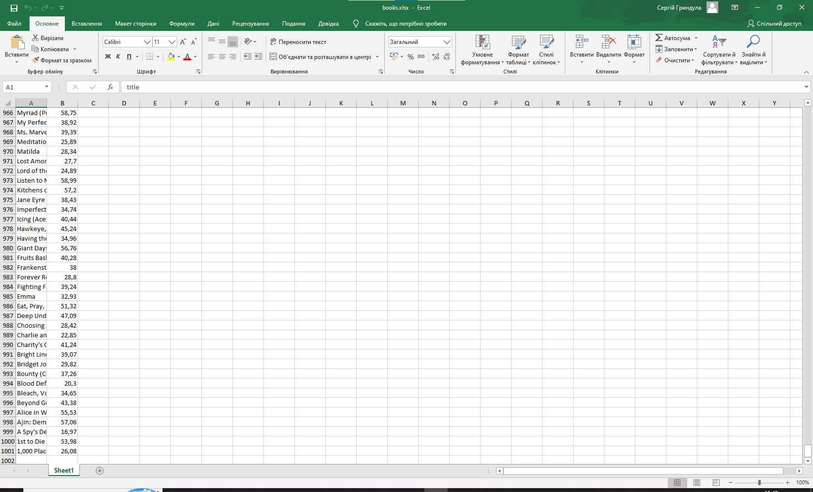

Цей проєкт - парсер, він збирає назви книг та їх ціни з усіх 50 сторінок тестового сайту (https://books.toscrape.com/index.html) і зберігає в CSV/Excel.

Стек: Python, requests, BeautifulSoup, pandas.

Щоб запустити потрібно клонувати цей репозиторій, потім в консолі написати pip install -r requirements.txt, та запустити parser.py.

У результаті 2 файли (books.csv, books.xlsx) на 1000 рядків з назвою книги та її ціною, також ці фали не лежеть у репозиторії, а створюються при запуску .

Далі планую розширити функціонал та парсити справжній сайт. 