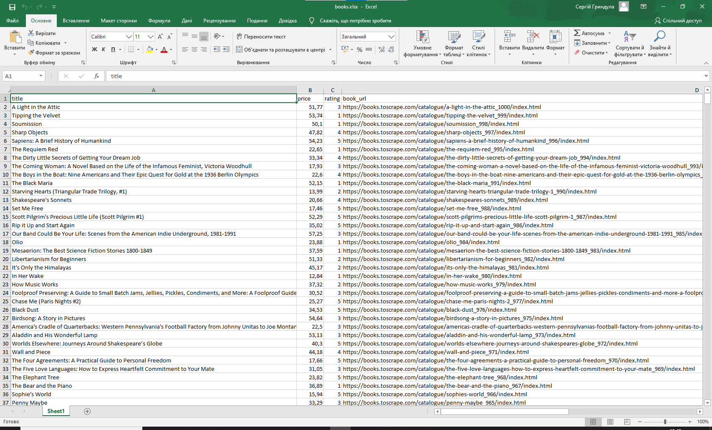

[English](README.md) | Українська 

# Sandbox: Books to Scrape Parser

Навчальний парсер, створений для відпрацювання базових навичок вебсканування на тестовому майданчику [Books to Scrape](http://books.toscrape.com/).

## Що збирає скрипт
Скрипт проходить по каталогу книг та витягує базову інформацію про кожне видання:
* Назву книги
* Ціну
* Рейтинг (кількість зірок)
* Посилання на сторінку книги

## Приклад результату


## Запуск проекту
1. Переконайтеся, що активовано віртуальне середовище та встановлені залежності з кореня проєкту.
2. Запустіть скрипт:
   ```bash
   python sandbox_books_toscrape/parser.py