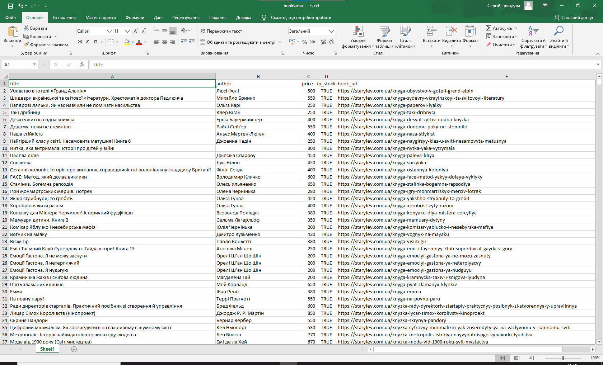

English | [Українська](README.uk.md)

# Stary Lev Publishing Parser

A web scraper for the product catalog of the "Old Lion Publishing House" website.

## What the Project Scrapes
The script successfully collected a dataset of **4,775 items** (as of October 23, 2026) from the publisher's book list.

### Columns (Data Structure)
* title - Book title.
* author - Author (or authors) of the book.
* price - Current price.
* `book_url - Direct link to the product page.
* in_stock - Stock status (whether it is available for purchase).

## Resulting Dataset Sample (CSV/XLSX)


## Main Challenges
* **Pagination and Catalog Structure:** Handling a large number of pages and correctly collecting links without duplicates.
* **Data Cleaning:** Removing extra spaces, line breaks, and handling cases where certain fields (for example, the price) were missing or had unusual HTML layout.

## Web Scraping Ethics
This project follows polite scraping rules:
1. **Checking robots.txt:** Allowed rules on the site were analyzed before running the scraper.
2. **Delays Between Requests (Rate Limiting):** A custom delay (`time.sleep`) was added between requests to the publisher's server to avoid creating heavy load and prevent IP blocking.

## How to Run
1. Make sure your virtual environment is activated and dependencies from the root directory are installed.
2. Run the script:
   ```bash
   python starylev/parser.py